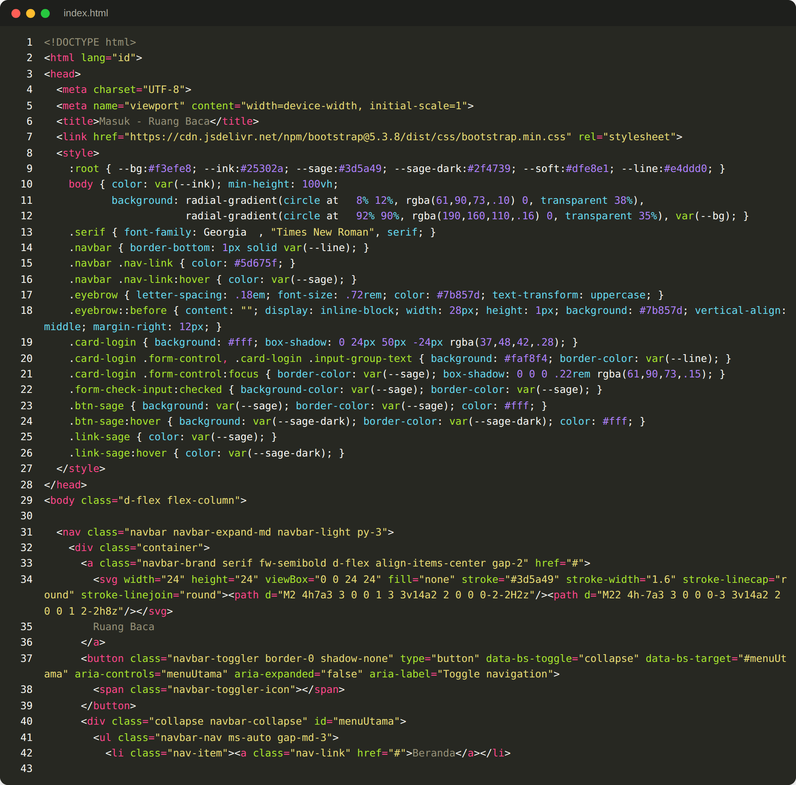
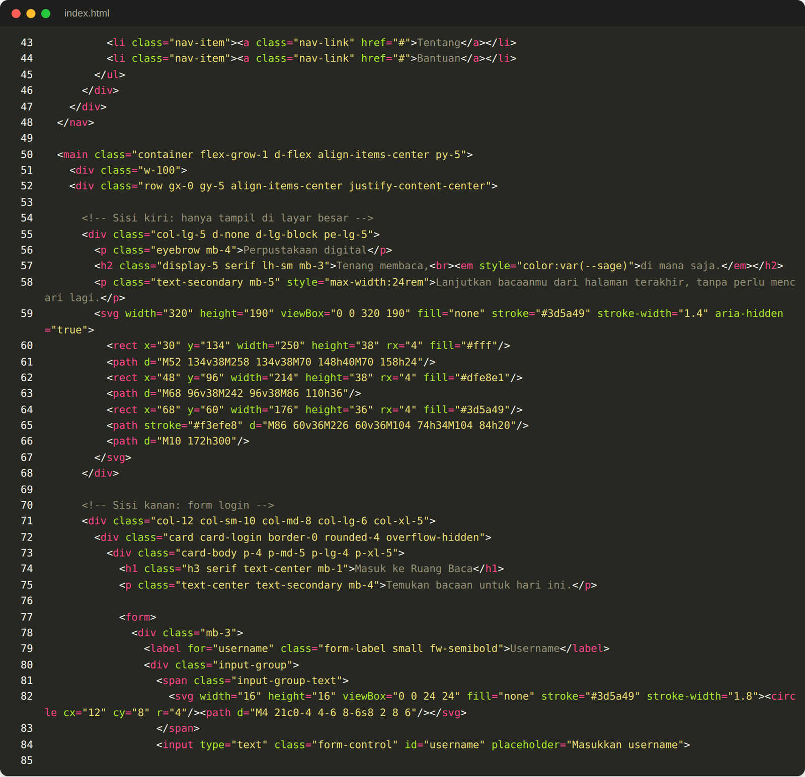
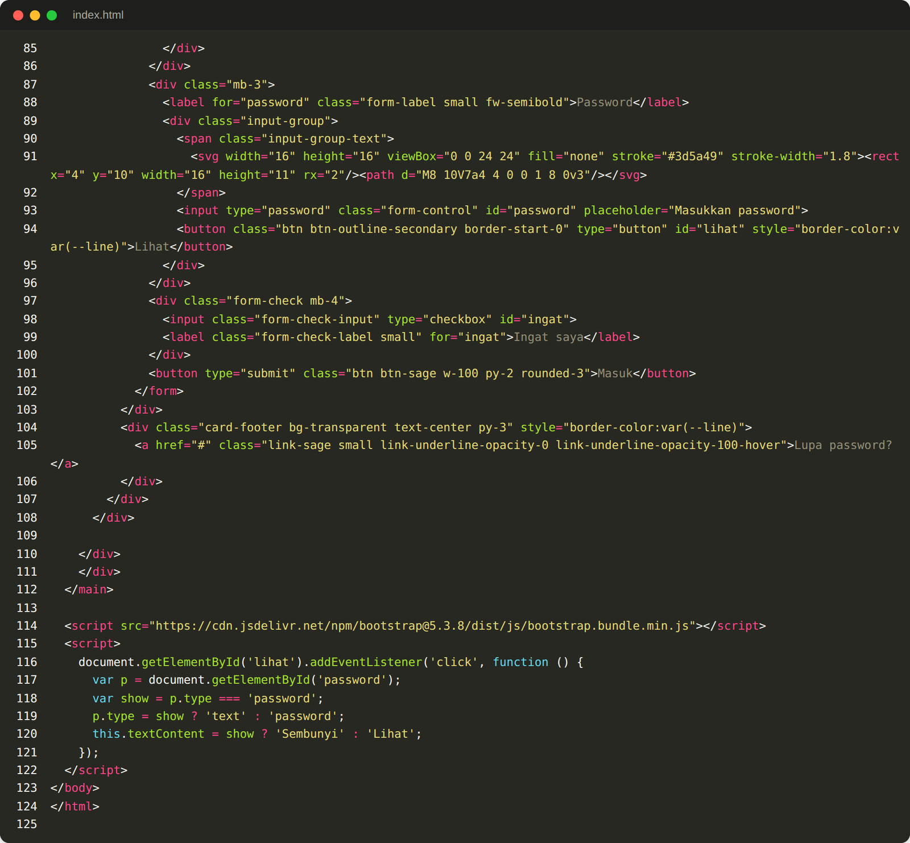
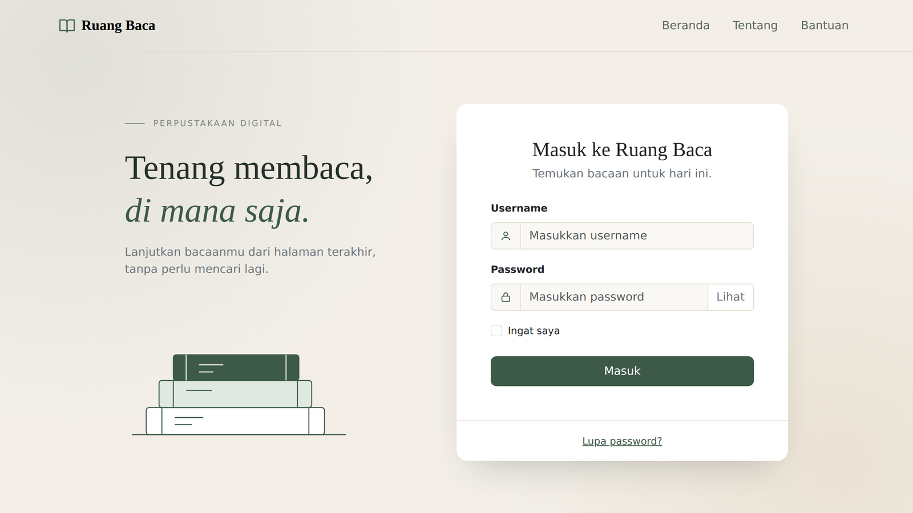
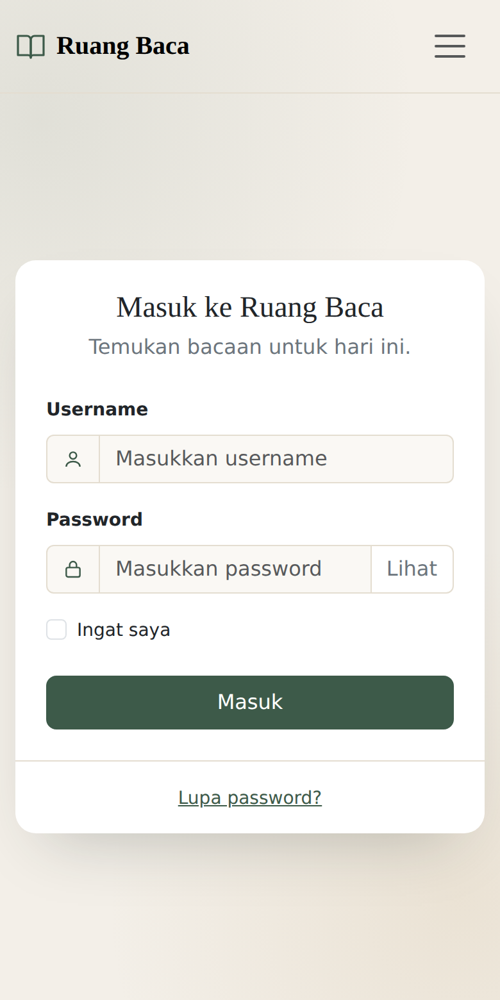

<p align="center"></p>

<h1 align="center">Tugas Pendahuluan Modul 5</h1>
<h3 align="center">Pemrograman Web – Ganjil 2026/2027<br>“Bootstrap”</h3>

| | |
|---|---|
| **Nama** | Lalu Abiyu Tsani |
| **NIM** | 103092400045 |
| **Versi Bootstrap** | 5.3.8 |

---

## 1. Pengertian Bootstrap [10 poin]

> Jelaskan apa itu Bootstrap dan apa kegunaannya!

Bootstrap adalah framework front-end open source berbasis HTML, CSS, dan JavaScript yang menyediakan kumpulan class dan komponen siap pakai untuk membangun tampilan website yang responsif dan *mobile-first*. Kegunaannya antara lain:

- Mempercepat pembuatan antarmuka karena komponen seperti navbar, card, form, button, dan modal sudah tersedia.
- Membuat tampilan responsif di berbagai ukuran layar melalui sistem grid dan breakpoint.
- Menjaga konsistensi desain dan kompatibilitas antar browser.
- Mengurangi penulisan CSS manual berkat utility class untuk spacing, warna, flexbox, bayangan, dan lainnya.

## 2. Memasang Bootstrap [10 poin]

> Ada beberapa cara untuk mengimpor atau menggunakan Bootstrap pada project. Sebutkan caracaranya!

1. **CDN**: menautkan file CSS dengan `<link>` di `<head>` dan JS bundle dengan `<script>` sebelum `</body>`.
   ```html
   <link href="https://cdn.jsdelivr.net/npm/bootstrap@5.3.8/dist/css/bootstrap.min.css" rel="stylesheet">
   <script src="https://cdn.jsdelivr.net/npm/bootstrap@5.3.8/dist/js/bootstrap.bundle.min.js"></script>
   ```
2. **Download manual**: mengunduh file CSS dan JS terkompilasi dari [getbootstrap.com](https://getbootstrap.com), menyimpannya di folder project, lalu menautkannya dengan path lokal.
3. **Package manager**: memasang lewat npm (`npm install bootstrap@5.3.8`), yarn, pnpm, atau composer, lalu mengimpornya dari `node_modules`.
4. **Source Sass**: mengimpor file Sass/SCSS Bootstrap agar variabel seperti warna dan font dapat diubah sebelum dikompilasi.

## 3. Grid dan Breakpoint [10 poin]

> Jelaskan mengenai class grid dan kegunaan breakpoint!

**Grid** Bootstrap adalah sistem tata letak berbasis flexbox dengan 12 kolom. Strukturnya terdiri dari `.container` sebagai pembungkus, `.row` sebagai baris, dan `.col-*` sebagai kolom. Lebar kolom ditentukan oleh jumlah dari 12 bagian, misalnya `col-md-6` berarti setengah lebar, `col` berarti lebar otomatis sama rata, dan `col-12` berarti satu baris penuh. Jarak antar kolom (gutter) diatur dengan class `g-*`.

**Breakpoint** adalah titik lebar layar tempat tata letak berubah. Kegunaannya agar satu halaman dapat tampil berbeda sesuai perangkat, misalnya satu kolom di ponsel dan tiga kolom di desktop (`col-12 col-md-4`). Class dengan infix breakpoint berlaku mulai ukuran tersebut ke atas (pendekatan *mobile-first*).

| Breakpoint | Infix | Lebar layar |
|---|---|---|
| Extra small | *(tanpa infix)* | < 576px |
| Small | `sm` | ≥ 576px |
| Medium | `md` | ≥ 768px |
| Large | `lg` | ≥ 992px |
| Extra large | `xl` | ≥ 1200px |
| Extra extra large | `xxl` | ≥ 1400px |

## 4. Class Bootstrap [10 poin]

> Sebutkan minimal lima class yang disediakan oleh Bootstrap beserta kegunaannya!

| Class | Kegunaan |
|---|---|
| `container` / `container-fluid` | Pembungkus konten; lebar tetap atau selebar layar |
| `row`, `col-*` | Membentuk baris dan kolom pada sistem grid |
| `btn btn-success` | Membuat tombol dengan gaya dan warna tertentu |
| `card`, `card-body` | Komponen kartu sebagai wadah konten |
| `navbar`, `navbar-expand-md` | Membuat navigation bar yang collapse pada layar kecil |
| `form-control`, `form-label` | Menata input dan label formulir |
| `d-flex`, `justify-content-center` | Mengatur layout flexbox dan perataan |
| `p-*`, `m-*`, `mb-3` | Mengatur padding dan margin |
| `text-center`, `text-muted` | Mengatur perataan dan warna teks |
| `bg-light`, `shadow`, `w-100` | Mengatur warna latar, bayangan, dan lebar penuh |

## 5. Gambar Responsif [10 poin]

> Bagaimana cara agar foto atau gambar pada website responsif menyesuaikan ukuran layar perangkat?

Tambahkan class `img-fluid` pada elemen ``:

```html

```

Class ini menerapkan `max-width: 100%` dan `height: auto`, sehingga gambar mengecil mengikuti lebar elemen induknya tanpa merusak rasio dan tidak melebihi ukuran aslinya. Gambar juga dapat ditempatkan di dalam kolom grid agar ukurannya mengikuti breakpoint. Alternatif lain adalah elemen `<picture>` atau atribut `srcset` untuk memilih file gambar berbeda pada tiap ukuran layar.

## 6. Membuat Tampilan dengan Bootstrap [50 poin]

> Buat tampilan halaman login **Ruang Baca** pada file `index.html` dengan memanfaatkan class Bootstrap.

### a. Screenshot Kode

<p align="center"><br><sub>Gambar 1. Kode <code>index.html</code> (bagian 1 dari 3)</sub></p>
<p align="center"><br><sub>Gambar 2. Kode <code>index.html</code> (bagian 2 dari 3)</sub></p>
<p align="center"><br><sub>Gambar 3. Kode <code>index.html</code> (bagian 3 dari 3)</sub></p>

<details>
<summary>Lihat kode lengkap <code>index.html</code></summary>

```html
<!DOCTYPE html>
<html lang="id">
<head>
  <meta charset="UTF-8">
  <meta name="viewport" content="width=device-width, initial-scale=1">
  <title>Masuk - Ruang Baca</title>
  <link href="https://cdn.jsdelivr.net/npm/bootstrap@5.3.8/dist/css/bootstrap.min.css" rel="stylesheet">
  <style>
    :root { --bg:#f3efe8; --ink:#25302a; --sage:#3d5a49; --sage-dark:#2f4739; --soft:#dfe8e1; --line:#e4ddd0; }
    body { color: var(--ink); min-height: 100vh;
           background: radial-gradient(circle at 8% 12%, rgba(61,90,73,.10) 0, transparent 38%),
                       radial-gradient(circle at 92% 90%, rgba(190,160,110,.16) 0, transparent 35%), var(--bg); }
    .serif { font-family: Georgia, "Times New Roman", serif; }
    .navbar { border-bottom: 1px solid var(--line); }
    .navbar .nav-link { color: #5d675f; }
    .navbar .nav-link:hover { color: var(--sage); }
    .eyebrow { letter-spacing: .18em; font-size: .72rem; color: #7b857d; text-transform: uppercase; }
    .eyebrow::before { content: ""; display: inline-block; width: 28px; height: 1px; background: #7b857d; vertical-align: middle; margin-right: 12px; }
    .card-login { background: #fff; box-shadow: 0 24px 50px -24px rgba(37,48,42,.28); }
    .card-login .form-control, .card-login .input-group-text { background: #faf8f4; border-color: var(--line); }
    .card-login .form-control:focus { border-color: var(--sage); box-shadow: 0 0 0 .22rem rgba(61,90,73,.15); }
    .form-check-input:checked { background-color: var(--sage); border-color: var(--sage); }
    .btn-sage { background: var(--sage); border-color: var(--sage); color: #fff; }
    .btn-sage:hover { background: var(--sage-dark); border-color: var(--sage-dark); color: #fff; }
    .link-sage { color: var(--sage); }
    .link-sage:hover { color: var(--sage-dark); }
  </style>
</head>
<body class="d-flex flex-column">

  <nav class="navbar navbar-expand-md navbar-light py-3">
    <div class="container">
      <a class="navbar-brand serif fw-semibold d-flex align-items-center gap-2" href="#">
        <svg width="24" height="24" viewBox="0 0 24 24" fill="none" stroke="#3d5a49" stroke-width="1.6" stroke-linecap="round" stroke-linejoin="round"><path d="M2 4h7a3 3 0 0 1 3 3v14a2 2 0 0 0-2-2H2z"/><path d="M22 4h-7a3 3 0 0 0-3 3v14a2 2 0 0 1 2-2h8z"/></svg>
        Ruang Baca
      </a>
      <button class="navbar-toggler border-0 shadow-none" type="button" data-bs-toggle="collapse" data-bs-target="#menuUtama" aria-controls="menuUtama" aria-expanded="false" aria-label="Toggle navigation">
        <span class="navbar-toggler-icon"></span>
      </button>
      <div class="collapse navbar-collapse" id="menuUtama">
        <ul class="navbar-nav ms-auto gap-md-3">
          <li class="nav-item"><a class="nav-link" href="#">Beranda</a></li>
          <li class="nav-item"><a class="nav-link" href="#">Tentang</a></li>
          <li class="nav-item"><a class="nav-link" href="#">Bantuan</a></li>
        </ul>
      </div>
    </div>
  </nav>

  <main class="container flex-grow-1 d-flex align-items-center py-5">
    <div class="w-100">
    <div class="row gx-0 gy-5 align-items-center justify-content-center">

      <!-- Sisi kiri: hanya tampil di layar besar -->
      <div class="col-lg-5 d-none d-lg-block pe-lg-5">
        <p class="eyebrow mb-4">Perpustakaan digital</p>
        <h2 class="display-5 serif lh-sm mb-3">Tenang membaca,<br><em style="color:var(--sage)">di mana saja.</em></h2>
        <p class="text-secondary mb-5" style="max-width:24rem">Lanjutkan bacaanmu dari halaman terakhir, tanpa perlu mencari lagi.</p>
        <svg width="320" height="190" viewBox="0 0 320 190" fill="none" stroke="#3d5a49" stroke-width="1.4" aria-hidden="true">
          <rect x="30" y="134" width="250" height="38" rx="4" fill="#fff"/>
          <path d="M52 134v38M258 134v38M70 148h40M70 158h24"/>
          <rect x="48" y="96" width="214" height="38" rx="4" fill="#dfe8e1"/>
          <path d="M68 96v38M242 96v38M86 110h36"/>
          <rect x="68" y="60" width="176" height="36" rx="4" fill="#3d5a49"/>
          <path stroke="#f3efe8" d="M86 60v36M226 60v36M104 74h34M104 84h20"/>
          <path d="M10 172h300"/>
        </svg>
      </div>

      <!-- Sisi kanan: form login -->
      <div class="col-12 col-sm-10 col-md-8 col-lg-6 col-xl-5">
        <div class="card card-login border-0 rounded-4 overflow-hidden">
          <div class="card-body p-4 p-md-5 p-lg-4 p-xl-5">
            <h1 class="h3 serif text-center mb-1">Masuk ke Ruang Baca</h1>
            <p class="text-center text-secondary mb-4">Temukan bacaan untuk hari ini.</p>

            <form>
              <div class="mb-3">
                <label for="username" class="form-label small fw-semibold">Username</label>
                <div class="input-group">
                  <span class="input-group-text">
                    <svg width="16" height="16" viewBox="0 0 24 24" fill="none" stroke="#3d5a49" stroke-width="1.8"><circle cx="12" cy="8" r="4"/><path d="M4 21c0-4 4-6 8-6s8 2 8 6"/></svg>
                  </span>
                  <input type="text" class="form-control" id="username" placeholder="Masukkan username">
                </div>
              </div>
              <div class="mb-3">
                <label for="password" class="form-label small fw-semibold">Password</label>
                <div class="input-group">
                  <span class="input-group-text">
                    <svg width="16" height="16" viewBox="0 0 24 24" fill="none" stroke="#3d5a49" stroke-width="1.8"><rect x="4" y="10" width="16" height="11" rx="2"/><path d="M8 10V7a4 4 0 0 1 8 0v3"/></svg>
                  </span>
                  <input type="password" class="form-control" id="password" placeholder="Masukkan password">
                  <button class="btn btn-outline-secondary border-start-0" type="button" id="lihat" style="border-color:var(--line)">Lihat</button>
                </div>
              </div>
              <div class="form-check mb-4">
                <input class="form-check-input" type="checkbox" id="ingat">
                <label class="form-check-label small" for="ingat">Ingat saya</label>
              </div>
              <button type="submit" class="btn btn-sage w-100 py-2 rounded-3">Masuk</button>
            </form>
          </div>
          <div class="card-footer bg-transparent text-center py-3" style="border-color:var(--line)">
            <a href="#" class="link-sage small link-underline-opacity-0 link-underline-opacity-100-hover">Lupa password?</a>
          </div>
        </div>
      </div>

    </div>
    </div>
  </main>

  <script src="https://cdn.jsdelivr.net/npm/bootstrap@5.3.8/dist/js/bootstrap.bundle.min.js"></script>
  <script>
    document.getElementById('lihat').addEventListener('click', function () {
      var p = document.getElementById('password');
      var show = p.type === 'password';
      p.type = show ? 'text' : 'password';
      this.textContent = show ? 'Sembunyi' : 'Lihat';
    });
  </script>
</body>
</html>
```

</details>

### b. Screenshot Hasil

**Tampilan desktop**

<p align="center"><br><sub>Gambar 4. Tampilan desktop</sub></p>

**Tampilan ponsel**

<p align="center"><br><sub>Gambar 5. Tampilan ponsel</sub></p>

### Penjelasan singkat

- **Navbar**: `navbar navbar-expand-md` dengan brand di kiri dan menu `ms-auto` di kanan. Di layar kecil menu berubah menjadi tombol hamburger (`navbar-toggler`).
- **Form login**: `card` dengan `rounded-4`, berisi `form-label`, `input-group`, `form-control`, `form-check`, dan tombol `w-100`.
- **Responsif**: kartu memakai grid `col-12 col-sm-10 col-md-8 col-lg-6 col-xl-5`, dan sisi kiri hanya tampil di layar besar (`d-none d-lg-block`).
- **Utility**: `shadow`, `rounded-*`, `p-*`, `mb-*`, `text-center`, `text-secondary`, `gap-*`, dan `flex-grow-1`.

## Struktur Repository

```
.
├── README.md
├── index.html
└── images/
    ├── header.png
    ├── code1.png
    ├── code2.png
    ├── code3.png
    ├── desktop.png
    └── mobile.png
```

## Cara Menjalankan

Buka `index.html` langsung di browser. Koneksi internet diperlukan karena Bootstrap dimuat melalui CDN.
